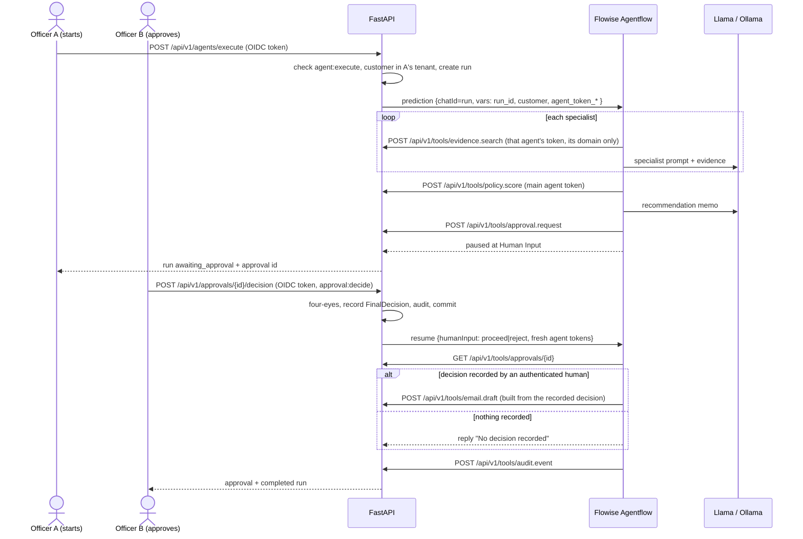

# Flowise Integration

How the Flowise Agentflow and Chatflow use the platform's identity, authorization, approval and audit controls.

## Division of responsibility

| Concern | Owner |
| --- | --- |
| Reasoning, prompt construction, specialist agents, routing between branches | Flowise Agentflow V2 |
| Run record, agent identities, tool authorization, tenant and customer scope | FastAPI (`app/services/agent_runtime.py`, `app/routers/v1/tools.py`) |
| Approval gate, credit decision of record, resume of a paused flow | FastAPI (`app/routers/v1/approvals.py`) |
| Audit trail (hash-chained) | FastAPI (`app/services/audit_chain.py`) |
| Deterministic DTI/LTV/rate rules | FastAPI (`app/policy/loan_policy.py`) |

Flowise never holds the state that decides who may do what. It runs an execution that FastAPI started, using credentials FastAPI issued for that execution.

## The two flows

| Flow | Id | Called by | Purpose |
| --- | --- | --- | --- |
| Credit Appraisal Agentflow (governed) | `b3c1d7e2-…` (`FLOWISE_AGENTFLOW_ID`) | `POST /api/v1/agents/execute` | Full appraisal with specialist agents, policy rules and human approval |
| RAG Chatflow (legacy) | `6f946e8b-…` (`FLOWISE_CHATFLOW_ID`) | `POST /chat` (LISA, Streamlit) | Conversational Q&A over customer documents |

## Governed Agentflow run



## Controls and where they are enforced

| Control | Enforcement | Test |
| --- | --- | --- |
| Each agent has its own identity | FastAPI mints one HS256 token per agent per call (`mint_run_tokens`), bound to run, tenant and customer, 15 min TTL | `test_full_run_pauses_for_human_and_records_decision_by_second_officer` |
| Agents only use their own tools | Scopes in `app/auth/agent_permissions.json`, checked per request; the generator refuses to build a node whose agent lacks the scope | `test_agent_cannot_use_another_agents_evidence_domain`, validator |
| A prompt cannot redirect a tool | Customer and tenant come from the token; a body `customer_id` must match | `test_injected_customer_id_cannot_redirect_tools` |
| Tokens are not exposed to the LLM | Tokens are only in HTTP `Authorization` headers; the validator fails if a prompt, reply or code node references one | validator security checks |
| No agent can make a credit decision | No agent scope covers decisions; `/final-decision` and `/api/v1/approvals/{id}/decision` reject agent principals | `test_agent_token_cannot_record_a_credit_decision_anywhere` |
| Clicking Proceed in Flowise records nothing | After resuming, the flow reads the decision from FastAPI and stops if none was recorded by an authenticated human | validator scenarios "Proceed/Reject clicked in Flowise" |
| Direct Flowise calls fail closed | Case Intake throws without `run_id`; tools return 401 without tokens; Flowise drops vars not on the flow's allow-list, so `fastapi_base_url` cannot be overridden | validator scenario "direct Flowise call" |
| Stolen tokens have little value | Tools only work while the run is `running` or `resuming`; tokens expire in 15 minutes | `test_tools_are_disabled_while_the_run_waits_for_a_human` |
| Four-eyes | The officer who started the run cannot decide it (`APPROVAL_REQUIRE_FOUR_EYES`) | happy-path test |
| Approval expiry | Pending approvals expire after `APPROVAL_TTL_HOURS` (default 48) | `test_expired_approval_cannot_be_decided` |
| Typed tool contracts | Pydantic models with `extra="forbid"`; exported to `flowise_project/agentflows/tool-schemas.json`; the validator checks every HTTP body against them | `test_tool_schemas.py`, validator |
| Audit of every tool call and denial | Hash-chained `audit_events`, written in the same transaction | `test_editing_an_audit_row_breaks_the_chain` |
| Correlation | `X-Correlation-ID` from the original request is passed to Flowise, sent by every HTTP node, and stored on audit events | gateway tests |

## Legacy RAG Chatflow

The Chatflow reads its own pgvector table (`flowise_rag_chunks`) directly, so FastAPI cannot authorize each retrieval. Its controls are weaker:

- FastAPI resolves the caller's tenant and checks the customer belongs to it before calling the flow.
- The Postgres metadata filter is `{customer, tenant_id}`; chunks are tagged with `tenant_id` at load time and by `scripts/ensure-flowise-flows.js`.
- The flow is no longer marked public (`isPublic = 0`), and the moderation deny-list includes identity- and tenant-switch phrases.

Use the Agentflow for anything that must be authorized per agent or ends in a decision.

## Running it

```bash
# Backend with dev auth (no Keycloak):
AUTH_DEV_MODE=true AUTH_DEV_JWT_SECRET=$(openssl rand -hex 32) ./start.sh

# Tokens for two officers (four-eyes):
cd bank-credit-ai-poc/backend
ALICE=$(AUTH_DEV_MODE=true AUTH_DEV_JWT_SECRET=... .venv/bin/python -m app.auth.dev_tokens --user alice --role loan_officer)
BOB=$(AUTH_DEV_MODE=true AUTH_DEV_JWT_SECRET=... .venv/bin/python -m app.auth.dev_tokens --user bob --role loan_officer)

curl -s -X POST localhost:8000/api/v1/agents/execute -H "Authorization: Bearer $ALICE" -H 'Content-Type: application/json' \
  -d '{"customer_id": 1, "request": "Run a full credit appraisal", "loan_amount": 250000, "collateral_value": 400000, "monthly_income": 12000, "monthly_debt_payments": 1800}'
# -> status awaiting_approval, approval.id

curl -s -X POST localhost:8000/api/v1/approvals/<approval id>/decision -H "Authorization: Bearer $BOB" -H 'Content-Type: application/json' \
  -d '{"decision": "conditional", "approved_amount": 230000, "approved_rate_pct": 7.75, "conditions": ["Updated valuation"]}'
```

For OIDC, set `OIDC_ISSUER`, `OIDC_AUDIENCE`, `OIDC_JWKS_URL` (and `OIDC_TENANT_CLAIM`); HS256 dev tokens are then rejected unless `AUTH_DEV_MODE=true`.

## Regenerate and validate

```bash
node flowise_project/agentflows/build-agentflows.js
node flowise_project/agentflows/validate-agentflows.js     # 9 scenarios x 3 environments
.venv/bin/python scripts/export_tool_schemas.py            # after changing a tool model
FLOWISE_RESEED=1 node scripts/seed-flowise-agentflow.js    # load into local Flowise
```

`seed-flowise-agentflow.js` upgrades a previously seeded pre-gateway Agentflow automatically and saves the old graph to `bank-credit-ai-poc/flowise/backups/`.

## Live verification (2026-10-18, local Flowise 3.1.2 + Ollama `gemma4:latest`)

A test FastAPI on port 8010 was run against the real local Flowise, PostgreSQL and Ollama, with synthetic customer `CUST-001`:

| Check | Result |
| --- | --- |
| `POST /api/v1/agents/execute` without a token | 401 with the error envelope and correlation id |
| Same request as an officer of another tenant | 404 `Customer not found` |
| Seeding an Agentflow seeded before the gateway | Upgraded automatically; the old graph was backed up |
| Real Flowise run: Router agent → appraisal branch | Routed correctly |
| Four domain evidence searches from Flowise | `POST /api/v1/tools/evidence.search` ×4, all 200, audited as `agent:credit_scoring`, `agent:asset_appraisal`, `agent:legal_policy` and `agent:fraud_aml` |
| Failure handling | Run marked `failed` with the Flowise error, audited, and the chain still verifies |
| Bug found and fixed | The in-memory retrieval cache dropped `document_id`, producing colliding citations (`chunk__0`). Fixed in `document_cache.py` (`tests/test_document_cache.py`) |

**Not verified live:** the specialist LLM nodes with structured output, and therefore the approval gate and resume, against real Flowise. With `gemma4:latest` (a "thinking" model), Flowise 3.1.2's LLM node got no usable response (`Cannot read properties of undefined (reading 'response_metadata')`), and on a second run the Router returned an empty string. Called directly through Ollama's OpenAI API, the same model returns valid tool calls and JSON-schema output. The likely cause is thinking-model output not reaching Flowise's `content` field. Next step: run with a non-thinking tool-calling model (`ollama pull llama3.1` or `qwen2.5`, then `FLOWISE_RESEED=1 LOCAL_LLM_MODEL=llama3.1:latest node scripts/seed-flowise-agentflow.js`), or with vLLM as configured for production. The approval and resume path is covered by `tests/test_agent_gateway.py` against a simulated flow and by the validator's dry runs.

## Known limitations

- Agent tokens appear in Flowise execution records (HTTP node inputs include headers). Short TTL and the run-status check limit their use; a production deployment should restrict access to Flowise execution history.
- Flowise prediction endpoints are not yet bound to a Flowise API key (`apikeyid`). The controls above hold without it, but binding it is the next hardening step and needs FastAPI's `FLOWISE_API_KEY` set to the same key.
- The tool gateway is MCP-style (typed schemas, manifest at `GET /api/v1/tools/manifest`) over HTTP; there is no MCP transport server yet.
- Approval expiry is checked lazily on read; escalation needs the durable workflow engine (IMPLEMENTATION_PLAN M6).
- Legacy unversioned routes stay anonymous unless `LEGACY_AUTH_MODE=required`; only `/chat` and `/final-decision` honour that mode so far.
- The Agentflow call is synchronous inside `POST /api/v1/agents/execute`; long local-model runs hold the request open (up to `FLOWISE_AGENTFLOW_TIMEOUT_SECONDS`).
